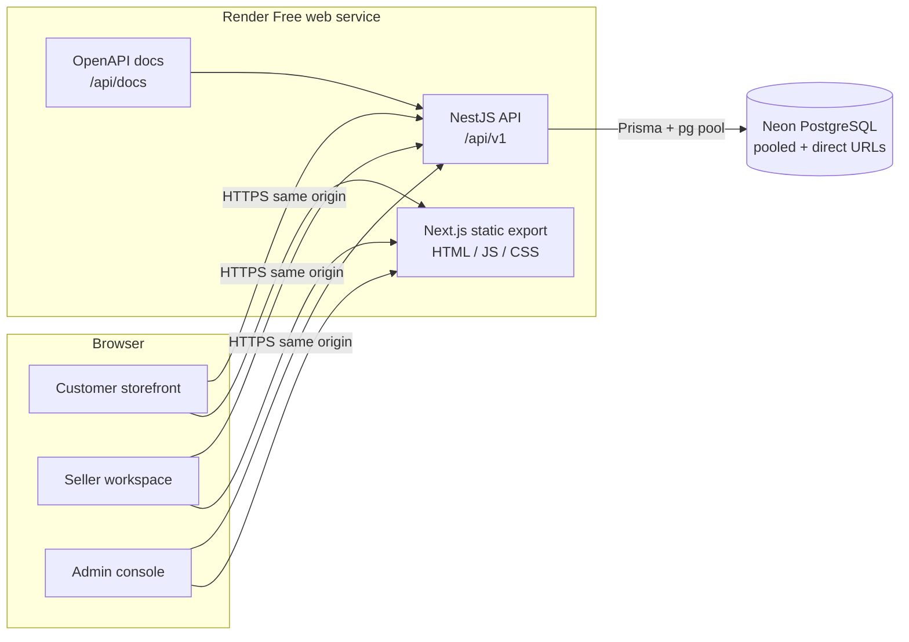
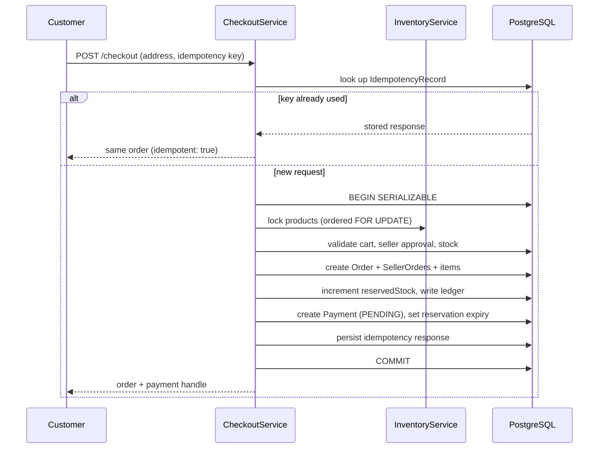
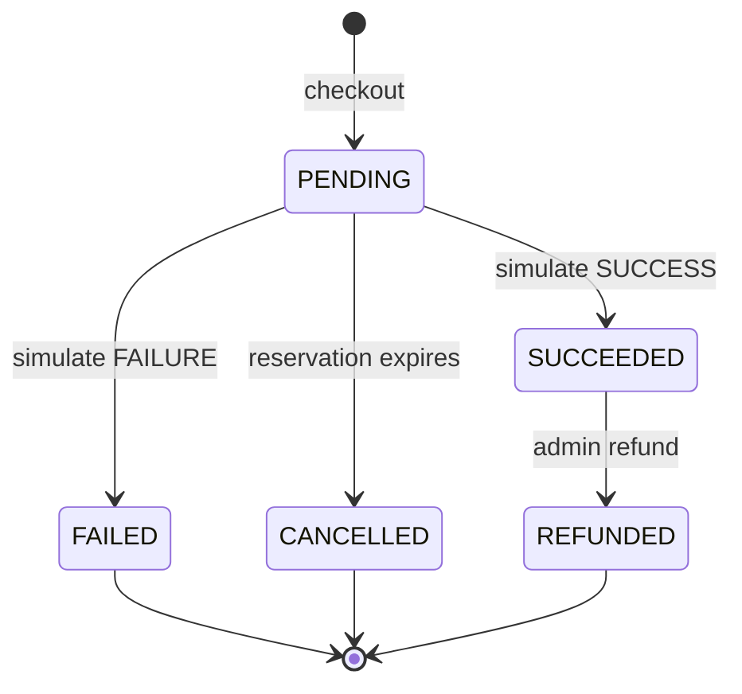
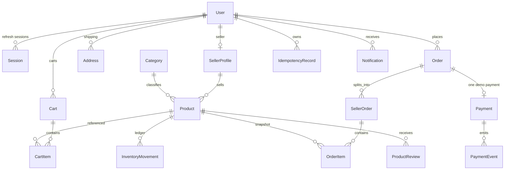

# Architecture

MarketHub is a single-origin deployment: one NestJS process serves the REST API and the pre-rendered Next.js frontend. This avoids CORS, cross-site cookie and SSR-time database problems on a free hosting tier while keeping a clear separation between the two applications in the monorepo.

## System context



- The frontend is a static export (`output: 'export'`). It contains no server components that read the database, no middleware and no server actions.
- Detail pages use fixed routes with query parameters (for example `/product?id=...`) so the export needs no dynamic segments.
- The API binds `0.0.0.0` and honours `PORT`.
- Unknown `/api/**` routes return JSON 404s; unknown page routes return the exported `404.html`.

## Request lifecycle

```mermaid
sequenceDiagram
  participant U as Browser
  participant N as NestJS
  participant G as Guards
  participant S as Service
  participant P as Prisma
  participant D as PostgreSQL

  U->>N: GET /api/v1/auth/csrf
  N-->>U: Set-Cookie mh_csrf (readable)
  U->>N: POST /api/v1/checkout + x-csrf-token + cookies
  N->>G: Throttler → JWT → Roles → CSRF
  G-->>N: authenticated customer, matching CSRF
  N->>S: checkout(userId, dto, idempotencyKey)
  S->>P: serializable transaction
  P->>D: BEGIN; SELECT ... FOR UPDATE; INSERT ...; COMMIT
  D-->>P: committed order, payment, reservation
  P-->>S: summary
  S-->>U: 201 order + payment summary
```

Guard order is global: rate limit, JWT authentication, role check, then CSRF for state-changing cookie requests. Bearer-token API clients and the one-time admin bootstrap bypass the CSRF check only.

## Checkout and inventory

Checkout is the most consistency-sensitive path. It runs inside a serializable transaction and is safe under concurrency.



Key properties:

- **Deterministic locking** — product rows are locked in sorted ID order, preventing deadlocks between concurrent baskets.
- **Serializable isolation** — conflicting checkouts either retry a bounded number of times or fail cleanly with `409`.
- **No oversell** — available stock is `stockOnHand - reservedStock`; the last unit can only be reserved once.
- **Reservation expiry** — a scheduled sweep and a lazy check before payment both release overdue reservations exactly once.
- **Append-only ledger** — every reservation, release and confirmed sale writes an `InventoryMovement`.

## Payment simulation



- On success, reserved units become a confirmed sale (`stockOnHand` decreases, `reservedStock` decreases) and the order moves to `PAID`.
- On failure, the reservation is released and the order is cancelled.
- Payment events are immutable and written in the same transaction as the status change.
- Money never leaves the platform; every payment record carries `simulated: true` and a note stating that no real money was charged.

## Order state machines

Seller groups advance only forward:

```
PENDING_PAYMENT → PAID → PROCESSING → SHIPPED → DELIVERED
        └──────────────┴──────────────┴──────────→ CANCELLED
```

The parent order is derived from its seller groups:

- all groups cancelled → `CANCELLED`
- all delivered → `DELIVERED`
- some delivered → `PARTIALLY_DELIVERED`
- all shipped (or delivered) → `SHIPPED`
- some shipped → `PARTIALLY_SHIPPED`
- any processing → `PROCESSING`
- otherwise → `PAID`

Invalid transitions return `409` and are covered by unit tests.

## Data model



Notable modelling choices:

- `OrderItem` stores product name, SKU and unit-price snapshots so historical orders are unaffected by later catalogue edits.
- `SellerOrder` is the unit of fulfilment and carries its own status, shipping subtotal and tracking reference.
- `IdempotencyRecord` is scoped by `(userId, scope, key)` with a stored response payload.
- Refresh tokens are stored hashed in `Session`; rotation revokes the previous session.

## Frontend architecture

- A single typed `api()` client calls relative `/api/v1` endpoints, attaches the CSRF header from the readable `mh_csrf` cookie, and performs one refresh-on-401 retry.
- `AuthProvider` and `CartProvider` hold session and cart state; guarded layouts redirect unauthenticated or wrong-role visitors.
- Data loading uses a small `useApiData` hook with loading, error and refresh states; skeletons are shown while loading.
- Seller and admin areas share a `DashboardShell` but have distinct navigation, density and visual treatments.
- No page displays invented revenue, orders or users: charts and counters read the live API, and empty states are explicit.

## Operational behaviour

- Startup requires `DATABASE_URL`, `DIRECT_URL`, both JWT secrets and an HTTPS `FRONTEND_ORIGIN` in production; it refuses to boot otherwise.
- Migrations run before the server starts; a failed migration aborts the deploy.
- Health endpoints: `/api/v1/health/live` (process) and `/api/v1/health/ready` (database ping).
- Access logs are structured JSON and deliberately exclude cookies, authorization headers and bodies.
- Transaction timeouts are widened to tolerate Neon cold starts.
